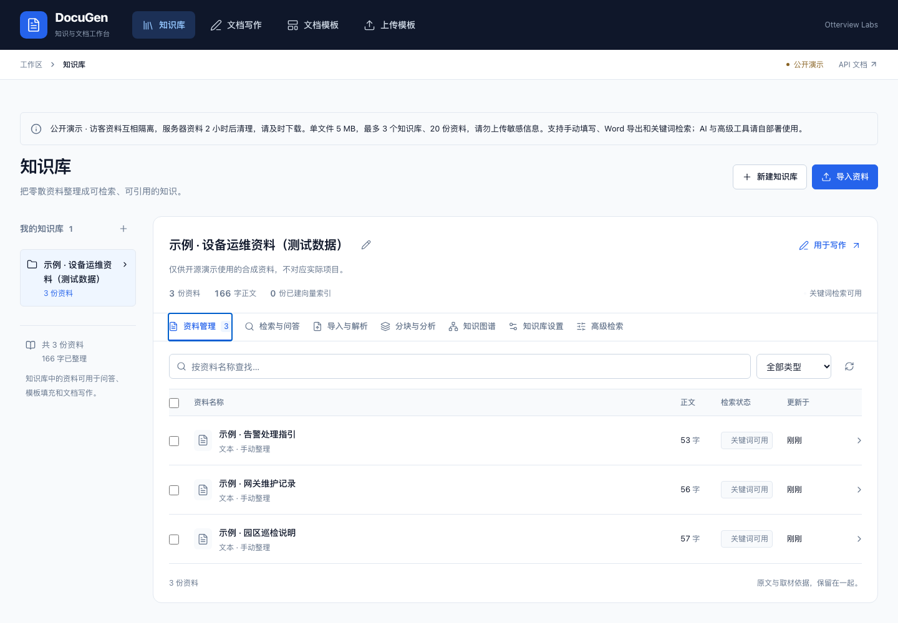
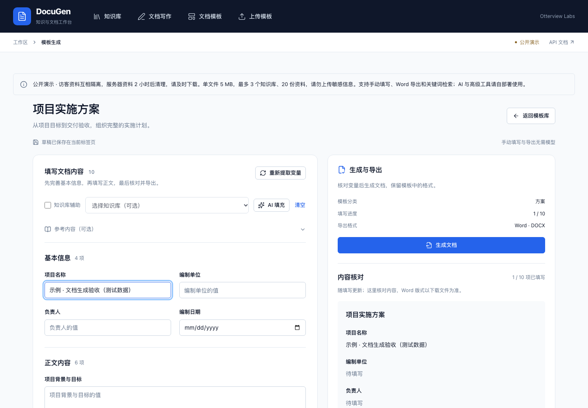

# Otterview DocuGen

Fill Word templates and draft documents from your own sources.

[](https://github.com/otterview-labs/DocuGen/actions/workflows/checks.yml)
[Apache-2.0](LICENSE) · **English** · [简体中文](README.zh-CN.md)

**[Try the live workspace](https://docugen.otterview.ai/templates?source=builtin)** · [Run locally](#run-locally) · [Architecture](docs/ARCHITECTURE.md) · [Report an issue](https://github.com/otterview-labs/DocuGen/issues)

[](https://docugen.otterview.ai/templates?source=builtin)

*Actual Chinese interface with labeled synthetic acceptance material.*

## Pick a starting point

| You have | What to do |
| --- | --- |
| A Word template | Upload it, fill the detected variables, and download a Word document with the template's formatting. |
| A folder of reference material | Import it into a collection, search it, and open the original sources alongside the results. |
| A document to write | Edit the outline, retrieve evidence for each section, and generate a draft with source snapshots. AI features require a configured model. |

Twelve starter templates include implementation plans, acceptance reports and meeting minutes.
Manual template filling and Word export work without a model. Generated text and final Word layout
still need review.

## Access the workspace

**[Open the online workspace](https://docugen.otterview.ai/templates?source=builtin)** · [Online features and deployment](docs/PUBLIC_DEMO.md)

The online workspace requires no model key and supports template filling, Word export, document import and keyword search. Server-side data is isolated per anonymous browser session and expires two hours after creation. Download your work promptly and do not upload sensitive material. Each session allows files up to 5 MB, three collections and 20 documents. AI, vector and advanced engine tools remain available in the self-hosted version.

For self-hosting, follow [Run locally](#run-locally) below or the [Docker deployment instructions](README.zh-CN.md#启动完整知识引擎), then open:

| Entry | URL after startup |
| --- | --- |
| Template library: preview, choose and fill a document | [http://127.0.0.1:8080/templates?source=builtin](http://127.0.0.1:8080/templates?source=builtin) |
| Import a Word template | [http://127.0.0.1:8080/create](http://127.0.0.1:8080/create) |
| Knowledge workspace | [http://127.0.0.1:8080/knowledge](http://127.0.0.1:8080/knowledge) |
| API documentation | [http://127.0.0.1:8080/docs](http://127.0.0.1:8080/docs) |

`127.0.0.1` refers to your own computer and requires a running installation. Local access, manual template filling and Word export need no access/model key. AI features require a configured model service; a local model can also run without a model API key. Ordinary self-hosting provides a single shared workspace; use the dedicated anonymous-access configuration for public anonymous access.

Choosing or importing a template opens the dedicated editor, with grouped basic/prose fields and a live content-check panel. Drafts are saved in the current browser tab and recover after refresh. Download the Word file to check its actual pagination and fonts.



## Upgrading from earlier versions

Version 0.2.1 is an early integration of the JetLinks knowledge runtime with selected DocuGen template and Word rendering methods. It is released under [Apache-2.0](LICENSE), with public release authorized by the project owner. [Provenance](docs/PROVENANCE.md) and [NOTICE](NOTICE) record source revisions and attribution. Historical runtime templates require a separate data migration.

This mainline integrates the former Quill workspace under the Otterview DocuGen name.
The original DocuGen is preserved on [`legacy/docugen-20261019`](https://github.com/otterview-labs/DocuGen/tree/legacy/docugen-20261019)
and the `docugen-legacy-20261019` tag. Its configuration, EasyRAG connection and some
APIs differ from the new workspace. Back up files, templates, databases and generated
artifacts and validate an upgrade separately before changing an existing deployment.

Existing Quill installations keep their `QUILL_*` settings, `quill` Python package,
data directories and original Compose project name, such as `docker compose -p quill`.
Changing a Compose project name creates separate volumes. New installations may use
`docugen`. Source, releases and issues are maintained in this repository; the former
Quill 0.1.0 source release is retained as a historical release.

## Run locally

```bash
git clone https://github.com/otterview-labs/DocuGen.git
cd DocuGen
uv venv --python 3.11
uv pip install --python .venv/bin/python -e '.[dev]'
cp .env.example .env
# Configure the OpenAI-compatible base URL, model, and credentials in .env.
npm --prefix frontend ci
npm --prefix frontend run build
.venv/bin/uvicorn quill.main:app --host 127.0.0.1 --port 8080 --workers 1
```

Open http://127.0.0.1:8080. Leave `QUILL_API_KEY` empty for direct local access; connection settings stay hidden in that mode. Enter the shared access key in the navigation's connection settings if `QUILL_API_KEY` is set. Workspace access and model-provider credentials are separate settings. The UI currently uses Chinese. Manual template filling works without a model. Manual reference text works without the knowledge service when a model is configured.

For the full local stack, set a strong `POSTGRES_PASSWORD`, leave `QUILL_API_KEY` empty for local use, then run `docker compose -p docugen up -d --build`. Only the workspace binds to loopback. Enable the shared key for network sharing. Keep the private knowledge engine and PostgreSQL off public networks. Semantic retrieval requires an embedding model with a matching configured dimension.

An existing local OpenAI-compatible model can also work without a model API key. For Ollama on the host, the Docker workspace can use `QUILL_LLM_BASE_URL=http://host.docker.internal:11434/v1` and an installed `QUILL_LLM_MODEL`, with both keys empty; native startup uses `http://127.0.0.1:11434/v1`. Set optional `QUILL_LLM_REASONING_EFFORT=none` only when the provider supports direct answers through that parameter. An empty value omits the parameter. This workspace generation configuration does not establish knowledge-engine analysis, embedding or graph readiness.

## Current boundaries

- DOCX templates, variable extraction, manual/AI filling, and Word downloads under the configured access mode.
- Collection creation/editing, PDF/DOCX/Markdown/TXT/CSV/JSON import, per-collection file deduplication, original downloads, title/tag editing, filtering, pagination and bulk removal.
- A source table and reading pane, content preview, reading segments, highlighted retrieval results and source navigation. Reading segments are not vector chunks.
- Text extraction is limited to 20 MB per file, 200 PDF pages and 200,000 extracted characters; scanned PDFs require prior OCR. Keyword retrieval works without a model; vector indexing and semantic retrieval require a configured embedding provider.
- Outline generation, per-section evidence retrieval, persisted jobs, and source snapshots.
- Interrupted jobs retain existing content and can be regenerated; they do not automatically resume.
- One API process and one task worker; no horizontal scaling or concurrent API workers.
- Model output and document formatting require human review. Source snapshots are not a guarantee of factual correctness.
- Upstream OCR, video, graph, and advanced parsers are retained as source but are not verified default-profile features.

## Checks

```bash
.venv/bin/python -m pytest tests
.venv/bin/python -m ruff check quill tests
npm --prefix frontend run build
```

Tests use controlled provider responses and do not call paid models. Upstream knowledge tests run in a separate process from `services/knowledge` after installing its text runtime profile.
