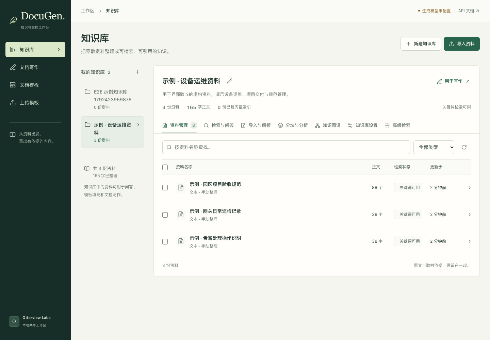
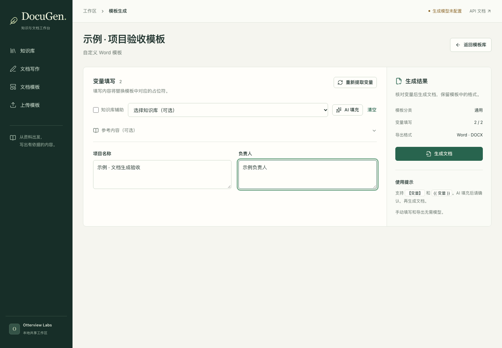

# Otterview DocuGen

把手头的资料放进知识库，查原文、填 Word 模板，或者按章节起草文档。

内置 12 种常用模板，包括项目实施方案、验收报告和会议纪要，采用统一的基础 Word 版式。也可以上传自己的模板，沿用其排版。旧运行环境另外上传的历史模板需要单独迁移。

已有 Word 模板时，可以上传模板，识别里面的变量，手动填写或让模型根据参考资料填入，再下载 Word。需要从头写文档时，可以先改大纲，再按章节生成，回头核对取用的资料。

当前为 **0.2.1**，按 [Apache-2.0](LICENSE) 发布。采用一个共享工作区，本机使用默认无需访问密钥，也可按需启用共享访问密钥，适合个人或可信团队自部署。没有多租户、独立用户权限或协同编辑。来源记录表示模型取材依据，不等同于逐句事实核验。

[English](README.en.md) · [架构与边界](docs/ARCHITECTURE.md) · [界面设计参考](docs/UI_REFERENCES.md) · [源码来源与发布条件](docs/PROVENANCE.md)

## 使用入口

DocuGen 当前提供自部署版本，**暂未提供公开托管的在线体验站**。先按照下文的[本地启动](#本地启动工作台)或[Docker 部署](#启动完整知识引擎)说明启动服务，再访问以下入口：

| 入口 | 启动后的访问地址 |
| --- | --- |
| 模板库：选择模板、查看版式、开始填写 | [http://127.0.0.1:8080/templates?source=builtin](http://127.0.0.1:8080/templates?source=builtin) |
| 上传自己的 Word 模板 | [http://127.0.0.1:8080/create](http://127.0.0.1:8080/create) |
| 知识库 | [http://127.0.0.1:8080/knowledge](http://127.0.0.1:8080/knowledge) |
| API 文档 | [http://127.0.0.1:8080/docs](http://127.0.0.1:8080/docs) |

`127.0.0.1` 指访问者自己的电脑，需要先启动服务。GitHub 仓库和右侧 Website 中的 Otterview 项目介绍页不运行文档工作台。本机默认无需访问密钥；上传模板、手动填写和导出 Word 无需模型。AI 填充与写作需要配置可调用的模型服务，也支持无需模型 API Key 的本地模型。

选择模板或完成上传后会进入独立填写工作台。基本信息与正文分组，内容核对区随填写更新；草稿保存在当前浏览器标签页中，可在刷新后恢复。Word 的实际分页与字体以下载文件为准。



资料列表和原文放在一起，查到内容后可以接着写作。截图使用明确标注的虚构验收资料。



上传自己的 Word 模板，填写识别出的变量，再生成文档。这个示例模板包含项目名称和负责人。

## 已接入的流程

- **知识库**：创建与编辑集合，批量导入 PDF、DOCX、Markdown、TXT、CSV、JSON 或粘贴文本；按名称和类型筛选、分页、编辑标题和标签、批量删除。相同文件在同一集合中自动去重，上传原件可下载。
- **原文与检索**：资料列表与原文预览并排，支持阅读分段、关键词高亮和来源跳转，也可将当前知识库带入写作。关键词检索无需模型；向量索引、语义检索和基于资料的问答需要对应模型配置。知识引擎通过内部 HTTP 协议连接。
- **模板文档**：上传 DOCX，提取 `【变量】` 和 `{{变量}}`，人工填写或使用 AI 辅助，导出 Word。复用 DocuGen 跨 run 占位符替换及表格处理。
- **文档写作**：生成并编辑大纲、按章节取材和写作、查看进度及中间内容、下载 Word。
- **持久化**：模板元数据、生成任务和产物来源写入 SQLite；知识资料与向量由知识引擎管理。重启后未完成任务标为“已中断”，保留内容，可重新生成。
- **失败可见**：知识引擎、模型不可用或所选知识库无命中时返回明确错误，不返回示例生成内容。

模板变量提取和填充覆盖正文、嵌套表格及已定义的页眉页脚，包括首页和偶数页版本。已验证跨 run 变量、合并单元格、粗体和页码字段保留；复杂图文排版仍需按实际模板验收。

占位符变量名两侧允许空格，例如 `{{ 项目名称 }}`。点击“提取变量”或“重新提取变量”会重新解析保存的 DOCX、更新变量记录，并保留同名字段已填写的内容。模板使用知识库辅助时，完整模板查询无命中会按最多 8 个字段名称进行关键词取材，最多保留 8 条去重来源；无命中仍明确报错，不补造资料。

## 版本与升级

当前主线整合了原 Quill 知识与文档工作台，产品名称统一为 **Otterview DocuGen**。

- 旧版 DocuGen 保存在 [`legacy/docugen-20261019`](https://github.com/otterview-labs/DocuGen/tree/legacy/docugen-20261019) 分支和 `docugen-legacy-20261019` 标签。旧版配置、EasyRAG 连接及部分 API 与新版不同，切换前请备份资料、模板、数据库和生成文件，并在独立环境验证。
- 已使用 Quill 的工作区继续沿用 `QUILL_*` 配置、`quill` Python 包名和原数据目录。已有 Docker 部署请继续使用原来的项目名（例如 `docker compose -p quill`），避免新建一组空数据卷；新安装可使用下文的 `docugen` 项目名。
- 后续代码、版本发布和问题反馈统一在本仓库维护。原 Quill 0.1.0 的源码发布保留在本仓库的历史 Release 中。

## 本地启动工作台

需要 Python 3.11+、Node.js 22.12+。在仓库根目录运行：

```bash
git clone https://github.com/otterview-labs/DocuGen.git
cd DocuGen
uv venv --python 3.11
uv pip install --python .venv/bin/python -e '.[dev]'
cp .env.example .env
# 编辑 .env：设置 QUILL_LLM_BASE_URL、QUILL_LLM_MODEL 和所需的 API Key。
npm --prefix frontend ci
npm --prefix frontend run build
.venv/bin/uvicorn quill.main:app --host 127.0.0.1 --port 8080 --workers 1
```

打开 [工作台](http://127.0.0.1:8080) 或 [API 文档](http://127.0.0.1:8080/docs)。本机使用时保持 `QUILL_API_KEY` 为空即可直接使用，页面不会显示密钥设置。按需设置 `QUILL_API_KEY` 后，在导航中的“连接设置”填入访问密钥。密钥仅保存在当前浏览器标签页的 sessionStorage 中；所有用户共用该密钥和工作区。不要将它当作独立用户登录系统。工作区访问密钥与 AI 模型服务凭据分别配置。

没有模型时仍可上传模板、手动填写并导出 Word。没有知识引擎时可用手动参考资料调用模型写作；知识库页面会说明连接问题。模型接口使用 OpenAI-compatible `/chat/completions` 协议，`QUILL_LLM_BASE_URL` 填基础 URL（通常以 `/v1` 结尾）。

已有本地模型服务时，工作区访问与模型调用都可以无需密钥。例如，本机运行已安装模型的 Ollama，Docker 工作台可配置 `QUILL_LLM_BASE_URL=http://host.docker.internal:11434/v1`、`QUILL_LLM_MODEL=实际已安装模型名`，保持 `QUILL_API_KEY` 和 `QUILL_LLM_API_KEY` 为空。原生启动时将地址改为 `http://127.0.0.1:11434/v1`。模型支持 `reasoning_effort` 时，可设置 `QUILL_LLM_REASONING_EFFORT=none` 让短任务直接生成正文；留空时不会向模型发送这个参数。AI 填模板、大纲和问答均保留较长请求超时以容纳模型冷启动。这些配置用于工作台生成调用，不表示知识引擎的摘要、向量和图谱已完成配置。

开发前端可运行 `npm --prefix frontend run dev`，Vite 会代理 `/api` 和 `/download` 到本机 8080。

需要无需 Docker 的本地文本知识库时，先安装文本引擎依赖，再启动两个本地进程：

```bash
uv pip install --python .venv/bin/python -r services/knowledge/requirements.quill.txt
.venv/bin/python scripts/dev.py
```

此模式使用本地 SQLite，默认支持文本入库和关键词检索；不承诺语义索引能力。知识库数据库位于 `data/knowledge.db`。macOS 如缺少 libmagic，可执行 `brew install libmagic`。不要同时运行另一套占用 8080 或 8006 的服务。

## 启动完整知识引擎

```bash
# 编辑 .env：设置随机 POSTGRES_PASSWORD；本机使用可保持 QUILL_API_KEY 为空。
docker compose -p docugen up -d --build
```

Compose 启动工作台、知识引擎、PostgreSQL + pgvector。只有工作台 8080 映射到 **127.0.0.1**；知识引擎和数据库不发布宿主机端口。三个服务的数据均存放在命名卷中。备份时分别保存三个卷；`docker compose down` 保留卷，`down -v` 会删除数据。

知识引擎默认按内部可信服务运行，跳过其旧用户认证，由 DocuGen 网关控制入口。**不要直接对公网发布知识引擎端口。** 网络共享需要自行配置 TLS 反向代理，并保留访问密钥。当前使用单个 DocuGen 进程和内置任务执行器，不支持多 worker 或横向扩容。

语义检索需要配置可调用的 Embedding 模型；维度由 `QUILL_EMBEDDING_DIMENSION` 指定，必须与模型输出一致。未配置时可以保存文本并使用关键词检索，界面会区分“已保存”和“已建立向量索引”。写作和 Embedding 默认复用同一模型网关地址与凭据。

工作台文件导入会提取文字，并私有保存原文件：单个文件不超过 20 MB，PDF 不超过 200 页，提取后正文不超过 20 万字符。PDF 扫描件需先自行 OCR；DOCX 按段落和表格顺序读取。页面中的“内容分段”帮助阅读，不代表已完成向量切分或索引。

原知识引擎保留多模态和知识图谱相关代码；OCR、视频、图谱等旧功能不属于已验证的默认部署能力。上游的 `requirements*.txt` 作为迁移参考保留，默认引擎使用 `requirements.quill.txt`。

## 验证

```bash
.venv/bin/python -m pytest tests
.venv/bin/python -m ruff check quill tests
# 安装知识引擎文本配置后，在独立 Python 进程中运行继承测试。
uv pip install --python .venv/bin/python -r services/knowledge/requirements.quill.txt
(cd services/knowledge && ../../.venv/bin/python -m pytest tests)
npm --prefix frontend run build
```

根目录测试覆盖模板上传、跨 run 替换、表格填充、下载认证、来源存储、知识库协议与分页、生成任务和重启恢复。模型契约使用受控响应，默认测试不消耗模型额度。真实模型质量及复杂 Word 排版需用自己的资料单独验收。

浏览器回归使用正在运行的本地服务（默认端口 18080，可通过 `QUILL_TEST_URL` 修改），会创建明确命名的验收模板：

```bash
(cd frontend && QUILL_TEST_URL=http://127.0.0.1:8080 npx playwright test)
```

测试从本地 `.env` 读取工作区访问密钥，也可设置 `QUILL_TEST_KEY`。运行前需要 Playwright Chromium 浏览器和根目录 `.venv`。

`local-access.spec.js` 验证免密本机模式。真实模型浏览器测试默认跳过；在独立测试工作区配置好本机模型并准备名为“示例 · 独立验收模板”的 DOCX（包含项目名称、负责人变量）后，可执行 `QUILL_REAL_LOCAL_MODEL=1 QUILL_TEST_URL=http://127.0.0.1:18080 npx playwright test e2e/local-model.spec.js`（在 `frontend` 目录中）。该测试会实际调用模型并保存合成文档，请使用隔离数据环境。

## 目录

```text
quill/                     统一 API、持久化、模型与知识库适配、生成任务
quill/legacy/              从 DocuGen 提取的模板处理和 Word 导出方法
frontend/                  基于 DocuGen Vue 工作台的统一入口
services/knowledge/        JetLinks 知识引擎源码与独立运行依赖
tests/                     DocuGen 集成与契约测试
docs/                      架构、来源清单与发布状态
compose.yaml               完整本地部署入口
```

项目归属 Otterview Labs。知识引擎和 Word 模板处理分别改编自 JetLinks knowledge runtime 与 DocuGen，保留原有署名及来源记录。项目所有者已确认两部分源码可公开发布；详见 [来源与授权记录](docs/PROVENANCE.md)、[NOTICE](NOTICE) 和 [LICENSE](LICENSE)。第三方依赖、模型和资料沿用各自的授权条款。
