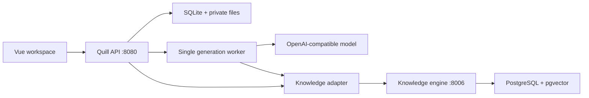

# Architecture and integration boundaries

Quill owns the user-facing API and UI. The knowledge engine owns collections, content, retrieval, and indexes. Document generation consumes a normalized evidence contract instead of importing the engine's internal ORM or DocuGen's old EasyRAG client.

The first merge preserves the existing Vue templates and layout. Quill adds knowledge and writing screens using the same form language, with a shared header and navigation. This is a functional integration, not a finished product redesign.

## Contracts

Quill routes use `/api/v1/knowledge/*` and `/api/v1/documents/*`. A narrow set of DocuGen routes (`/api/templates`, template upload/fill/render, `/download/*`) is maintained for the inherited frontend. Unsupported old routes are not carried forward.

The adapter maps collection pagination and `collection_id: list[str]` to the upstream API. Search results become source records with title, content snapshot, resource/content/collection identifiers, version if supplied, and score. These snapshots travel with the generated artifact metadata. Template sources are explicitly user-confirmed/client-supplied metadata; they are not signed attestations.

For writing, each section retrieves its own evidence. No-hit retrieval fails clearly. A failure preserves previous sections. Startup marks unfinished jobs interrupted, including queued jobs; the UI can submit the same request again. It does not claim automatic continuation or exactly-once delivery. An in-memory bounded queue dispatches jobs, while job state and output are persistent.

## Deployment boundary

The shared access key gates all workspace data and downloads. It is not a user identity. All authorized users see all templates and jobs. The private knowledge service runs with its compatibility development authentication settings behind the gateway; Compose publishes no engine or database ports. A deployment with separate user permissions needs a new identity and authorization contract before using it as a multi-user service.

Keep one Quill API worker. Multi-process startup recovery would otherwise interrupt another worker's jobs. For scale, replace the in-process queue and recovery logic with a durable task lease, queue, and dedicated workers.

Legacy knowledge code is retained under `services/knowledge`; source-level defects outside the integrated text profile may remain. The new ingestion endpoint avoids the broken upstream `process_text_content` path. Text saving reports vector-index availability separately from persistence.

## Next integration increments

1. Validate a real business template and complete a generation using the intended model/provider.
2. Add PDF/DOCX knowledge uploads to the unified workbench and validate parser dependencies.
3. Improve question-answering source navigation and citation review.
4. Improve template formatting fidelity, variable review and source navigation.
5. Add model-specific embedding configuration and reindex controls.
6. Introduce user identity only after defining workspace ownership and data access.
